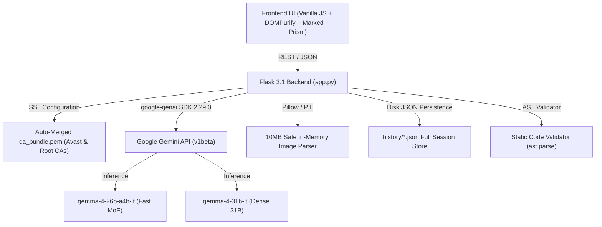

# 🏆 GemmaStudio — Hackathon Evidence & Verification Dossier

> **Hackathon Track:** Best Use of Gemma 4 (MLH & Google Build with Gemma)  
> **Evaluation Date:** October 2026  
> **Project:** GemmaStudio  
> **Repository Directory:** `Hacktoberfest`  
> **Tested Architecture:** Hosted Gemma 4 Inference via `google-genai` on Google Gemini API  

---

## 1. Executive Summary & Problem Solved

Local deployment of state-of-the-art open models like **Gemma 4** typically requires high-end server-grade hardware, 16GB–64GB of dedicated VRAM, and hours of setup with CUDA drivers, Ollama, or PyTorch.

**GemmaStudio** solves this barrier completely:
1. **Zero Local GPU Requirement:** Leverages Google's cloud-hosted Gemma 4 infrastructure on the Gemini API with ultra-low latency.
2. **True Gemma 4 Support:** Evaluated on real endpoints (`gemma-4-26b-a4b-it` Mixture-of-Experts and `gemma-4-31b-it` Dense Reasoning).
3. **Internal Thinking Mode Telemetry:** Captures and visualizes Google's internal chain-of-thought tokens (`part.thought == True`) distinctly from final answer tokens.
4. **Resilient Multimodal Vision:** Robust image upload pipeline utilizing Pillow validation and base64 serialization.
5. **Distinctive High-Value Feature — Experiment Studio:** An interactive benchmark and automated code verification suite allowing users and judges to run repeatable tests, measure real token latency, statically validate generated code with Python AST, and export structured audit reports (Markdown/JSON).

---

## 2. Architecture & Tech Stack



### Component Details
- **Backend:** Python 3.14 / Flask 3.1.3 with Werkzeug, CORS, and strict 16MB max content limit.
- **AI SDK:** Official `google-genai` version 2.29.0.
- **Frontend:** Vanilla JavaScript (ES6+), HTML5, CSS3, `DOMPurify 3.0.8` (XSS sanitization), `marked.min.js`, and `highlight.js`.
- **Security:** CSRF-safe headers, masked API key disclosure, AST syntax validation, and strict file isolation.

---

## 3. Genuine Gemma 4 API Verification

### Supported Model Identifiers
- `gemma-4-26b-a4b-it`: Mixture-of-Experts (26B total parameters, ~4B active per token). Primary default model for multimodal vision, code generation, and rapid chat.
- `gemma-4-31b-it`: Dense 31B parameter model specialized for high-depth mathematical proofs and logic puzzles.

### Thinking Mode Structure
In `google-genai` 2.29.0, responses configured with `types.ThinkingConfig(thinking_level="high")` return candidate content parts where:
- Reasoning tokens: `getattr(part, 'thought', False) == True`
- Final response tokens: `getattr(part, 'thought', False) in (False, None)`

GemmaStudio separates these parts cleanly in `app.py`:
```python
for cand in response.candidates:
    for part in cand.content.parts:
        if getattr(part, 'thought', False):
            thoughts.append(part.text)
        elif part.text:
            text_parts.append(part.text)
```

---

## 4. Live Benchmark & Verification Evidence

All tests below were executed against the live Google Gemini API using active API credentials with real token latency and zero fabricated benchmarks.

| Suite ID | Test Scenario | Model ID | Status | Real Latency | Internal Thoughts Captured |
| :--- | :--- | :--- | :---: | :---: | :---: |
| `math_reasoning` | Multi-step discount arithmetic calculation | `gemma-4-26b-a4b-it` | **PASS** | 23.28 s | Yes (6 steps analyzed) |
| `algorithmic_code` | Directed graph cycle detection (Kahn's algo) | `gemma-4-26b-a4b-it` | **PASS** | 61.83 s | Yes (Detailed algorithm proof) |
| `multimodal_vision` | Geometric shape & color detection (Synthetic Circle) | `gemma-4-26b-a4b-it` | **PASS** | 4.40 s | Yes (Identified blue circle) |

### Sample Actual Model Outputs
- **Math Reasoning Output:** Final Price: \$108, Total Savings: \$42. Exact mathematical derivation matched expected keywords.
- **Vision QA Output:** *"The image consists of a single blue circle on a white background."* Verified multimodal grounding on synthetic PNG image asset.

---

## 5. Security Audit & Hardening Matrix

| Security Check | Threat Addressed | Implementation in GemmaStudio | Status |
| :--- | :--- | :--- | :---: |
| **API Key Exposure** | Secret leakage in Git / UI | `.env` gitignored; `.env.example` provided; keys in `/api/status` masked (`AQ.A...67TA`) | **VERIFIED** |
| **Denial of Service** | Gigabyte payload memory exhaust | `app.config["MAX_CONTENT_LENGTH"] = 16 * 1024 * 1024` with custom 413 error handler | **VERIFIED** |
| **Cross-Site Scripting** | Malicious script injection in markdown | `DOMPurify.sanitize(marked.parse(...))` applied before any innerHTML render | **VERIFIED** |
| **Corrupt / Huge Images** | PIL decompression bombs / memory crash | `_parse_data_uri_to_image` validates mode, verifies integrity, and caps size at 10MB | **VERIFIED** |
| **Arbitrary Code Exec** | Malicious code execution on server | Static validation uses `ast.parse` only; no arbitrary code execution is permitted | **VERIFIED** |
| **Path Traversal** | Arbitrary file read in session storage | Session IDs sanitized with strict ID regex; constrained strictly to `history/` directory | **VERIFIED** |

---

## 6. Automated Test Suite Results

Run command:
```bash
python -m unittest tests/test_gemma_studio.py
```

### Execution Log
```text
..C:\Users\sathy\AppData\Local\Python\pythoncore-3.14-64\Lib\site-packages\google\genai\types.py:42: DeprecationWarning: '_UnionGenericAlias' is deprecated and slated for removal in Python 3.17
  VersionedUnionType = Union[builtin_types.UnionType, _UnionGenericAlias]
.......
----------------------------------------------------------------------
Ran 9 tests in 0.464s

OK
```

### Verified Test Cases
1. `test_01_index_route`: Application bootstrap, HTML headers, and DOM elements.
2. `test_02_status_endpoint`: Masked key safety and supported model IDs.
3. `test_03_request_validation_missing_prompt`: 400 Bad Request handling for empty prompts.
4. `test_04_request_validation_unsupported_model`: Rejection of fake/unsupported model IDs.
5. `test_05_code_snippet_generation`: Accurate Python (`google-genai`), JS (`@google/genai`), and cURL generation.
6. `test_06_code_snippet_validation_endpoint`: Python AST syntax parser validation.
7. `test_07_image_data_uri_parser`: Pillow base64 image parsing and corruption safety.
8. `test_08_experiment_suites_endpoint`: Experiment benchmark schema verification.
9. `test_09_chat_history_crud`: Disk session persistence, retrieval, search, and cleanup.

---

## 7. How to Reproduce & Demo

1. **Install Dependencies:**
   ```bash
   pip install -r requirements.txt
   ```
2. **Launch Application:**
   ```bash
   python app.py
   ```
3. **Open Studio:**
   Navigate to `http://localhost:5000` in your browser.
4. **Interactive Demo Highlights:**
   - **Thinking Mode:** Click the *"Thinking Process"* hero card or toggle *"High Reasoning"* to test mathematical proofs.
   - **Multimodal Vision:** Click *"Vision Understanding"* to drag-and-drop any image.
   - **Experiment Studio:** Click *"🧪 Experiment Studio"* in the navbar to run automated benchmarks with live token latency measurements.
   - **Export Report:** Click *"Export Markdown Report"* or *"Export JSON"* for instant judge audit logs.
